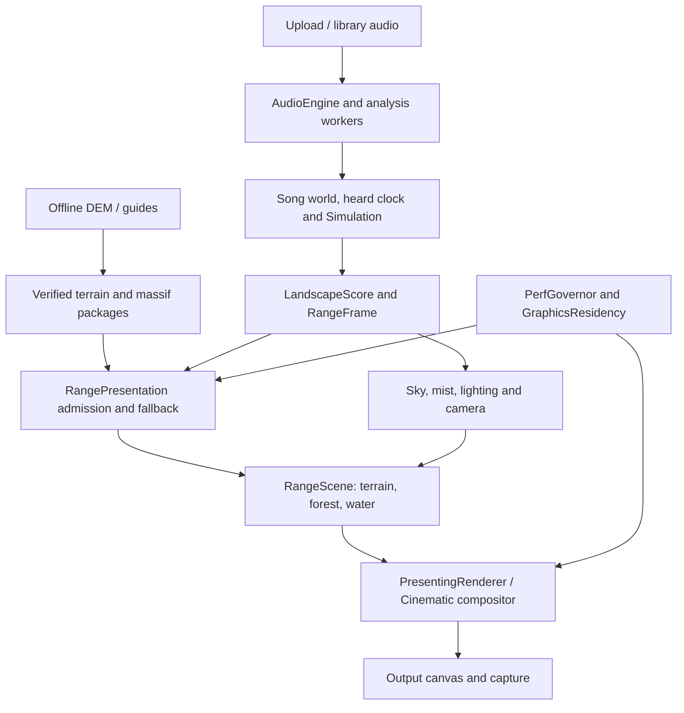

# Architecture

Verified against main `58454dd`, 2026-11-13. This describes active paths;
[decision 0001](decisions/0001-agent-verification.md) records reconnaissance and
historical conflicts. The repository is a native browser ES-module app, not a
framework bundle. Node tools prepare assets, serve and stage the application.

`src/main.js` owns upload, analysis adoption, boot and the requestAnimationFrame
loop. `AudioEngine`, `EnergyCurves`, onset/key/section analysis and worker modules
under `src/audio/` and `src/core/` produce musical evidence. Simulation and
BiomeManager advance the heard clock and world state. Opening analysis can be
replaced by whole-song results: history and committed-time handoff keep already
heard construction/weather/camera from jumping. Export APIs sample a fixed clock;
these are useful for screenshots and cannot measure delivered live FPS.

**Returning summits** is available under **Settings → Landscape**.
After the opening pass, a worker measures the full recording’s pitch-class motion.
It emits a versioned 16-height outline and timed points for recurring 12-second
passages. Pitch intervals give a transposed riff similar coordinates. Each
recording retains its own heard clock, dynamics and lighting. The analysis
cache keeps the full descriptor per recording, and the library retains its outline.

The scene planner compares this outline with surveyed terrain silhouettes, using
a precomputed table regenerated by `node tools/build-songprint-skylines.mjs`.
Recordings with a measured timeline place two to five intact surveyed massif
blocks beside the heard-time flight. Loudness and harmonic tension rank the
catalog by rawness. A returning timed lyric family or acoustic phrase can
place the same massif at a later point on the route. The existing Timed lyric
grounding setting controls lyric lookup. Trusted verses and choruses anchor
summit encounters; later lyric admissions steer the camera without rebuilding
the land. A timed English line naming a river or peak can draw the view
toward the corresponding feature. The landscape stores timing and family
identifiers, never lyric text. The flight crosses the generated watershed,
whose tributaries drain to one boundary outlet independently of the camera.

The closest eligible view selects the biome. The song's outline guides the
choice of measured massifs within that biome, and Returning summits keeps the
principal and companion massifs. The Songprint stage extends to 89.6 km on each
side. `InlandRegion.js` builds its landform in one pass: the outline sets two
flanking ranges, a trunk valley, a basin at the outline's lowest stretch and a
cross range. No seed is drawn from the outline. Its standardised cosine
coefficients turn the region and set each design choice, and the fine noise is
one fixed ground laid out in the region's own frame. Another recording of the
song, whose outline lies close, therefore builds nearly the same land, turned a
few degrees. The massifs add their own uplift. A drainage-area
erosion pass on a 233 m lattice (implicit stream power with stochastic flow
routing) cuts the valleys, spurs, passes and basins together. Rivers are traced
from the same network, so they follow low ground and join downhill to one
outlet. Each reach is shaped by its setting: broad floors in open country,
inner gorges where the river crosses high ground. The surveyed pieces stand on
this landform in local stage metres. Assembly yields between slices. If the
region misses the song's loading budget, the catalog view carries the play.

Inland tiles store samples at the 80 m surface-atlas spacing across the
travelled area, so rivers and hillside shading come from the atlas at full
detail. The mesh draws 40 m samples along flown valleys (80 m on mobile), 80 m
on core hillsides and coarser ground outward. Rivers are a surface class
(flow byte 254) shaded in the opaque terrain pass, with no planar reflection.
Material bands are carried from each pack's surveyed elevation span onto the
region's floor and crests. Woods grow in stands that the shader's mean canopy
and the placed instances share. Instances fill the stands within about a
kilometre of the flown rivers, up to a stable cap per budget.

With Music-timed tours enabled, the inland camera follows the region's
drainage. The opening runs low up the trunk valley, about 100 m above the
river. Middle stages alternate between valley runs and pass climbs that drop
into the next valley, and the music sends its quieter stage up for the wide
view. The close rises to face the returning summits. Arrivals at stage
boundaries fall on musical transitions, smoothed energy paces travel between
them, and the field of view stays fixed. The original bounded orbit remains
available as a fallback if a composed flight cannot be admitted.
Listener zoom, Camera Studio, authored rails and
explicit tours have their own controls. Late
analysis blends in at its admission time, and a fresh replay or full export
can use the complete descriptor from the start. Related arrangements can
select different homes near a catalog boundary, and unrelated songs can
share a peak.

**Recurring weather**, in the same settings section, can run independently.
Its analysis retains groups of directly matched, non-overlapping phrases.
The score selects a sparse set of returns from one family. The recording's
dynamics scale the clearing of existing valley mist and a small gust in the
scene's wind direction. Precipitation keeps its ordinary eligibility and
onset. A strong return near the end of an eligible storm can shorten the
existing rain fade. Playback, seeking and export sample these gestures on the
heard clock.

Camera Studio supplies immutable optional settings through Simulation/RangeFrame;
its heard-time routes share terrain/forest coverage and sky projection. The
frame-by-frame browser MP4 exporter reuses the fixed clock and encodes source
audio with WebCodecs and a pinned local muxer. See [Camera Studio](camera-studio.md)
and [video export](video-export.md).

Configuration flows through one settings registry (`src/config/settingsRegistry.js`)
and store (`src/config/appSettings.js`): URL overrides, saved preferences and
defaults resolve once per page, the Settings panel is generated from the
definitions, and `main.js` applies each change at its lifecycle boundary. See
[settings](settings.md) and the generated [URL parameters](url-parameters.md).

`LandscapeScore` compiles growth, weather and camera-related cues, including
one `CinematicPulse` that both `RangeCamera` and `LandRise` sample at heard
time; `RangeFrame` snapshots shared music, atmosphere, geometry/camera controls
and viewport state. CPU geometry, GLSL displacement, depth, ownership and
reflection passes must agree on growth and geographic coordinates. `LandRise`
uses one source-space floor, with catalog scalar growth, composed stage slot
growth and an explicit Dual Summits signature path. `LandRiseCamera`,
`RangeCamera`, rails, scene travel and optional tours resolve composition and
clearance. Seek sampling must remain deterministic rather than relying on
accumulated frames.

`RangePresentation` lazily loads the Range backend, owns asynchronous preparation,
view/scene transitions and generation cancellation, and supplies legacy fallback
when a current scene cannot be admitted. `RangeAssets` verifies pinned package
bytes before decoding. `TerrainMesh` constructs typed arrays on a shared sample
lattice; `TerrainChunks` culls without changing source geometry. `RangeScene`
uses the vendored Three.js subset for WebGL terrain, forest, water, depth, probes
and reflections. `StageAssembly` builds deliberate artworks from measured massif
pieces; those arrangements do not preserve original inter-mountain coordinates.

`PresentingRenderer`, `PixelPresentation`, `CinematicPixel` and crest composition
combine native terrain grids and output-space layers. Cinematic is the only
current effective Look; full-color smooth sky is deliberate. `RangeSkyRenderer`,
`RangeStorm`, `RangeAtmosphere`, `ValleyMistEngine`, cloud shadows and biome effects
share musical/scene state. Mist has valley receivers, activity and quality recovery;
it is already implemented. Effects must preserve terrain readability.

`PerfGovernor` is the single adaptive quality authority (levels 0–6);
`RangeQuality` specifies its scene consumers. `GraphicsResidency` accounts for
owned GPU/CPU graphics resources, pending allocations, pinning and generation
release. The ledger is not the browser's total memory. Display resolution,
terrain grid detail, GPU pass shedding and admission are separate controls.

Geographic authoring has multiple pipelines: profile modules from guided DEMs
([terrain pipeline](terrain-pipeline.md)), v2 terrain packages and tours under
`src/assets/range/v2/`, and massif/composition catalogs under `src/world/terrain/`.
Offline `tools/build-*`, terrain baking/fetch tools and provenance manifests
record source, resolution and hashes; playback does not fetch raw DEM tiles.
`tools/stage-site.mjs` is the production build and verifies asset/runtime pins.
Do not edit a generated asset independently of its manifest and checks.

Existing tests cover these relationships extensively. New verification commands
reuse `visual-evaluation-browser.mjs` for actual upload/analysis/rendering and
`visual-evaluation-server.mjs` for immutable source serving. Experimental compiled
terrain, direct-terrain and shading alternatives remain documented experiments.
Do not mistake a historical spec, disconnected module or optional prototype for
the active application. `ridgeview/` is a separate viewer with its own tests.
