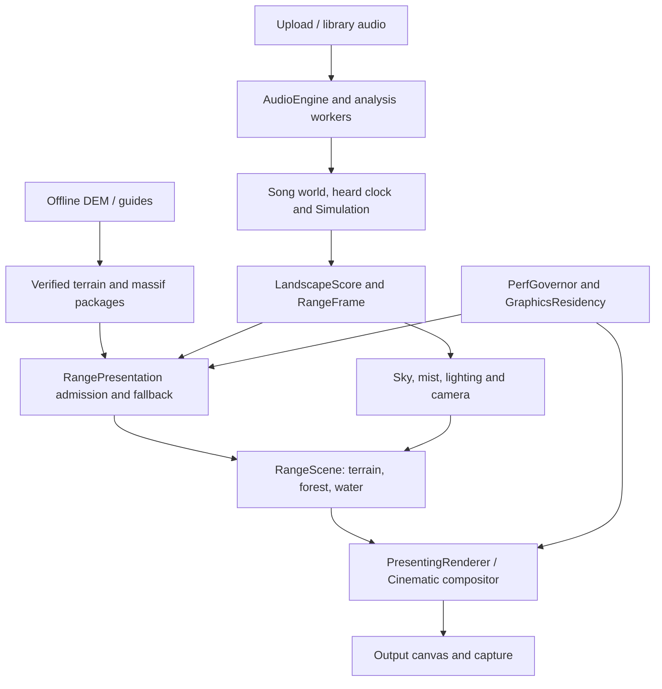

# Architecture

Verified against main `58454dd`, 2026-11-13. This describes active paths;
[decision 0001](decisions/0001-agent-verification.md) records reconnaissance and
historical conflicts. The repository is a native browser ES-module app, not a
framework bundle. Node tools prepare assets, serve and stage the application.

`src/main.js` owns upload, analysis adoption, boot and the requestAnimationFrame
loop. `AudioEngine`, `EnergyCurves`, onset/key/section analysis and worker modules
under `src/audio/` and `src/core/` produce musical evidence. Simulation and
BiomeManager advance the heard clock and world state. Opening analysis can be
replaced by whole-song results: history and committed-time handoff keep already
heard construction/weather/camera from jumping. Export APIs sample a fixed clock;
these are useful for screenshots and cannot measure delivered live FPS.

Configuration flows through one settings registry (`src/config/settingsRegistry.js`)
and store (`src/config/appSettings.js`): URL overrides, saved preferences and
defaults resolve once per page, the Settings panel is generated from the
definitions, and `main.js` applies each change at its lifecycle boundary. See
[settings](settings.md) and the generated [URL parameters](url-parameters.md).

`LandscapeScore` compiles growth, weather and camera-related cues;
`RangeFrame` snapshots shared music, atmosphere, geometry/camera controls and
viewport state. CPU geometry, GLSL displacement, depth, ownership and reflection
passes must agree on growth and geographic coordinates. `LandRise` uses one
source-space floor, with catalog scalar growth, composed stage slot growth and
an explicit Dual Summits signature path. `LandRiseCamera`, `RangeCamera`, rails,
scene travel and optional tours resolve composition and clearance. Seek sampling
must remain deterministic rather than relying on accumulated frames.

`RangePresentation` lazily loads the Range backend, owns asynchronous preparation,
view/scene transitions and generation cancellation, and supplies legacy fallback
when a current scene cannot be admitted. `RangeAssets` verifies pinned package
bytes before decoding. `TerrainMesh` constructs typed arrays on a shared sample
lattice; `TerrainChunks` culls without changing source geometry. `RangeScene`
uses the vendored Three.js subset for WebGL terrain, forest, water, depth, probes
and reflections. `StageAssembly` builds deliberate artworks from measured massif
pieces; those arrangements do not preserve original inter-mountain coordinates.

`PresentingRenderer`, `PixelPresentation`, `CinematicPixel` and crest composition
combine native terrain grids and output-space layers. Cinematic is the only
current effective Look; full-color smooth sky is deliberate. `RangeSkyRenderer`,
`RangeStorm`, `RangeAtmosphere`, `ValleyMistEngine`, cloud shadows and biome effects
share musical/scene state. Mist has valley receivers, activity and quality recovery;
it is already implemented. Effects must preserve terrain readability.

`PerfGovernor` is the single adaptive quality authority (levels 0–6);
`RangeQuality` specifies its scene consumers. `GraphicsResidency` accounts for
owned GPU/CPU graphics resources, pending allocations, pinning and generation
release. The ledger is not the browser's total memory. Display resolution,
terrain grid detail, GPU pass shedding and admission are separate controls.

Geographic authoring has multiple pipelines: profile modules from guided DEMs
([terrain pipeline](terrain-pipeline.md)), v2 terrain packages and tours under
`src/assets/range/v2/`, and massif/composition catalogs under `src/world/terrain/`.
Offline `tools/build-*`, terrain baking/fetch tools and provenance manifests
record source, resolution and hashes; playback does not fetch raw DEM tiles.
`tools/stage-site.mjs` is the production build and verifies asset/runtime pins.
Do not edit a generated asset independently of its manifest and checks.

Existing tests cover these relationships extensively. New verification commands
reuse `visual-evaluation-browser.mjs` for actual upload/analysis/rendering and
`visual-evaluation-server.mjs` for immutable source serving. Experimental compiled
terrain, direct-terrain and shading alternatives remain documented experiments.
Do not mistake a historical spec, disconnected module or optional prototype for
the active application. `ridgeview/` is a separate viewer with its own tests.
