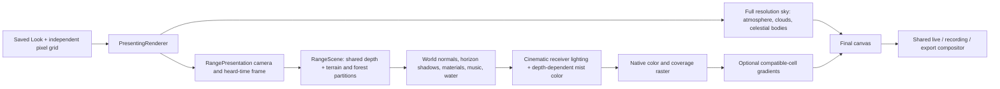

# Cinematic Pixel (experimental)

Select **Display → Look → Cinematic Pixel (experimental)**. Pixel detail stays independent: select **Classic+ — 400×225** for a direct comparison with Pixel at Classic+. The saved default remains Pixel. Cinematic Pixel uses continuous color rather than palette quantization; choose Palette to retain the existing fixed-palette workflow. Trio keeps its established presentation.

The implementation uses real geometry and live procedural shading. It retains the existing terrain packages, forest placement, camera/tours, music clock, water, actors, weather, material LOD and scene ownership. No reference bitmap is used in rendering.

The [architectural investigation](superpowers/specs/2026-10-24-cinematic-pixel-design.md) and [execution plan](superpowers/plans/2026-10-24-cinematic-pixel.md) describe the alternatives and source findings. The supplied goal image guides value hierarchy, atmosphere and color relationships; its precise composition is not a procedural guarantee.

## Image construction



`DisplayProfile.js` carries an opt-in `look: 'cinematic'` in the version-2 record. It resolves to `cinematicPixel: true`, retaining grid/quality/scaling. `PresentingRenderer` passes the gate before each draw to the terrain scene and sky snapshot. `RangeScene.resize` stores the gate even when render-target dimensions do not change. Every frame refreshes shared `uCinematic` and `uCinematicAir` vectors; resident forest windows, river surfaces and mirrors use the same profile. Switching back resets it without regenerating terrain or forest assets.

Terrain and trees use a narrower wrap key, lower directional-light residual inside terrain-horizon shadow, restrained cool fill and warm key, and one shared highlight-preserving grade. Individual trees now consult the same baked geographic horizon as far canopy. Crown detail still fades according to projected footprint; materials reduce unresolved normal detail rather than adding screen noise. Forest gust accents use the same cinematic ambient response.

The existing exponential height-layer mist is integrated along the real camera-to-surface ray. The cinematic profile reduces ordinary near haze through optical depth, retains deep-bank convergence, and preserves full cloud-sea opacity. Its larger visible improvement is **depth-dependent atmospheric color**: near air draws from the scene's own zenith radiance, then returns to the existing luminous mist at distance. Terrain and forest apply the same color law to both mist and broad air. A black environment adds no invented blue light. Storm rain, flash, cloud-sea timing and sunlight authority remain active.

The independent sky painter retains its original projection and density fields. Cinematic clouds blend pale cool volume with warm directional variants using continuous weights derived from the projected sun. The existing 48-bank cache owns these variants and one small mixing buffer. Variants are generated on first use, released with their density identity, on switching off or under quality shedding, and skipped when their reservation is denied. The sky also reduces faint stellar activity and aurora gain, and restrains the solar halo.

## Gradients inside pixel geometry

`CinematicPixel.js` uploads the completed native foreground once, samples the nearest cell and its four axial neighbors, and reconstructs a limited monotone color slope inside the cell. Partial alpha retains its exact nearest value. Missing coverage, contrasting colors, isolated extrema and nonmonotone detail reject a slope. Stepped silhouettes therefore retain their native ownership, while compatible low-frequency color can vary within a cell. The sky remains a separate smooth layer.

This is **color reconstruction**, not an independently sampled irradiance buffer or a depth-aware final filter. The forward shaders still evaluate lighting on the native grid. Similar-colored geometric boundaries can pass the color test; the reconstruction has no material/depth buffer with which to distinguish them. It uses no temporal accumulation, reprojected history or stochastic jitter, so it introduces no history ghosting or disocclusion trails.

The optional pass reserves its source texture and estimated drawing buffers in `GraphicsResidency` before allocating. The estimate is `12 × outputPixels + 4 × sourcePixels + 4096` bytes. Output reconstruction is capped at 3840×2160; scene geometry remains at the selected grid. Context loss, shader failure and budget refusal fall back to nearest presentation. The first restored frame recreates context-owned objects; denied resizing deletes and unbinds old GPU resources. Quality rungs **2–6** shed reconstruction (reason `quality`) and cached cloud tint variants before terrain admission; cinematic scene lighting, atmospheric color and sky composition remain active. The legacy title illustration does not retain a cinematic output buffer. Driver/context overhead is not included in the ledger's ownership estimates.

Live composition and capture use the same cell shader and fit calculation. Capture at a different resolution may resize the same optional pass; display and capture diagnostics are kept separately, and current scratch ownership is updated. Recording rebuilds the sky/foreground hybrid at the encoder dimensions. Palette passes never use this reconstruction.

## Artistic parameters

The starting recipe is explicit and tunable in `src/world/alpine/CinematicLighting.js`:

| Parameter | Current value | Effect |
|---|---:|---|
| `dayFill` / `nightFill` | 0.72 / 0.96 | Receiver hemisphere gain; night preserves sheltered readability |
| `dayShadow` / `nightShadow` | 0.18 / 0.42 | Remaining key behind the geographic horizon |
| `dayWrap` / `nightWrap` | 0.09 / 0.15 | Rock diffuse wrap; crowns add 0.10 |
| `dayAir` / `nightAir` | 0.68 / 0.84 | Ordinary air optical-density gain |
| `dayMist` / `nightMist` | 0.58 / 0.82 | Ordinary mist optical-depth gain |
| `airStartM` | 900 m | Clear near range for broad air |
| `mistNearM` | 1200 m | Smooth near shoulder for ordinary mist |
| `mistColorNearM` / `mistColorFarM` | 1800 / 18000 m | Near-zenith to distant-mist color transition |
| `mistNearSkyGain` | 0.72 | Near atmospheric source radiance; capped per channel by original mist |

The daylight recipe blends continuously toward night/overcast from the existing frame's night and storm values. Source `CINEMATIC_CELLS` exposes gradient strength 0.8 and color-discontinuity thresholds 0.04–0.18 in normalized RGB length. `RangeSkyRenderer._cinematicCloud` contains the small cloud light/shadow palette. These are source tuning controls, not additional end-user sliders.

Avoid reducing fill/exposure to compensate for an opaque cloud sea: inspect actual `render.mist.fill`, density and weather diagnostics first. A quiet passage may intentionally flood the valley; a daytime timestamp may still be inside a storm. The atmosphere is not supposed to look identical across these states.

## Reproduce and validate

```sh
npm ci
npm test
npm run lint
npm run stage:site
npm run review:landscape -- --out .smoke/pixel --grid classicPlus --look pixel --view nc-ross-lake-north --start-ms 60000 --seconds 2 --fps 12
npm run review:landscape -- --out .smoke/cinematic --grid classicPlus --look cinematic --view nc-ross-lake-north --start-ms 60000 --seconds 2 --fps 12
```

For the native RTX 3060 path from WSL, use `npm run test:gpu` and set `MIDIO_WINDOWS_NODE` to the native node.exe when it is outside Program Files/nodejs. That path now retains the source Git commit and dirty state in its frozen snapshot. It always stays headless and muted.

Different requested Looks are explicitly labeled A/B artistic studies; the matched-revision comparator still requires identical settings. Repeat the same Look/settings to test deterministic output or regressions. `--live-seconds 30` adds a separate actual-playback readiness/frame-delivery trace; fixed-clock clips are not FPS measurements. The native GPU unit fixture can be run with `PLAYWRIGHT_CHROMIUM_PATH` pointing to Chrome: `node --test test/cinematicPixelGpu.test.mjs`.

Bulk export accepts `--look cinematic --pixel-grid classicPlus`. The strict capture manifest accepts Cinematic only in version 2. Existing version-1 profiles, stored Natural/Depth migrations, Pixel/Palette and their defaults retain their established behavior.

## Limits and next improvements

The new mode improves value hierarchy and layered air; it does not guarantee the reference's authored composition, mountain shapes or hand-grouped vegetation. Low native grids still alias thin moving trees, and broad material/forest patterns can remain visibly regular. Mobile GPU/physical display acceptance requires separate device testing. The extra source upload and cross-context output copy have real cost, including first-use shader compilation; quality shedding is intentional.

Ranked next experiments: (1) improve broad geological face/material variation and reduce bright near-ground striping; (2) separate low-frequency irradiance/atmosphere from nearest material/coverage if cell-color reconstruction remains insufficient; (3) unify far/near forest crown value grouping and movement at thin silhouettes; (4) bounded directional scattering through the existing cloud/terrain depth; (5) camera composition scoring that favors quiet sky, readable foreground framing and multiple geographic depth layers. Require matched moving footage and measured cost before retaining each change.
